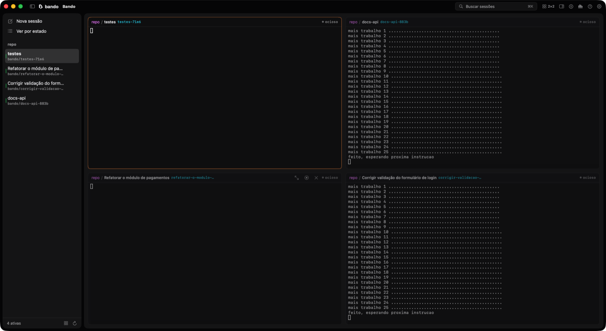

<p align="center">
  <picture>
    <source media="(prefers-color-scheme: dark)" srcset="assets/logo/bando-completo-branco.svg">
    
  </picture>
</p>

<p align="center">
  <strong>Vários agentes de código trabalhando em paralelo, cada um no seu worktree, numa janela nativa e leve.</strong>
</p>

<p align="center">
  
  
  
  
</p>

<p align="center">
  
</p>

O Bando abre cada tarefa numa **sessão**: um git worktree próprio, uma sessão tmux e o agente que você escolher (Claude Code, Codex, OpenCode, Antigravity ou qualquer outra CLI). Você acompanha todas pela lateral, vê várias ao mesmo tempo na grade e é avisado quando alguma precisa de você.

## Por que

- **Leve.** App nativo em SwiftUI, sem Electron e sem daemon. Fechar o app não derruba nada: os agentes seguem no tmux.
- **Qualquer agente, qualquer provider.** Agentes e providers vêm de arquivos TOML. Para usar uma CLI nova, ou o Claude Code pelo OpenRouter, você escreve umas linhas de configuração, sem recompilar.
- **Seus dados ficam com você.** Banco SQLite local, chaves no Keychain do macOS. As chaves só chegam ao processo do agente, nunca em argumentos, arquivos ou logs.

## Comparação

Com o [Xirp](https://backstage.spotify.com/docs/xirp), a ferramenta mais parecida, medidos na mesma máquina (macOS 26, Apple Silicon) em novembro de 2026 (Bando 0.1.21):

| | Bando | Xirp |
|---|---|---|
| Tecnologia | SwiftUI nativo + tmux | Electron + daemon em Node |
| Memória com o app aberto | ~145 MB com 3 terminais na grade | ~1 GB (16 processos) |
| Memória com o app fechado | ~6 MB por sessão (supervisor) | ~26 MB por sessão (processo Node); 387 MB com 14 sessões |
| Tamanho do app | 62 MB (Intel e Apple Silicon) | 623 MB |
| Processo em segundo plano | nenhum além do tmux e do supervisor de cada sessão | daemon sempre ativo |
| Atualização | automática, avisa na lateral e instala com um clique | automática |
| Agentes | qualquer CLI, por configuração (28 no catálogo) | 5, fixos no app |
| Providers de modelo | 53 no catálogo e os seus (OpenRouter, Bedrock, Ollama…) | login de cada CLI |
| MCP | cadastro único, entregue a todos os agentes | configurado em cada agente |
| Trocar de agente na sessão | sim, com resumo ou conversa levados ao novo agente | sim |
| Grade de sessões | até 4×4, tamanhos ajustáveis | sim |
| Temas | 15 e os seus, aplicados à janela inteira | tema escuro e claro |
| Relatórios | dia, semana, mês ou intervalo; exporta CSV e Markdown | retrospectiva semanal |
| Custo por sessão e janela de contexto | sim | sim |
| Código | aberto (MIT) | fechado |
| Sistemas | macOS | macOS |

Quem já usa o Xirp pode trazer projetos, sessões, custos e PRs com `bando import xirp`; sessões que estão rodando são adotadas sem reiniciar o agente.

## Recursos

**Sessões**
- Worktree e branch por sessão, sem copiar o repositório (fica no mesmo disco, ao lado do projeto). O branch ganha o nome do título da sessão (`bando/corrigir-login-6c19`).
- Worktree pronto para rodar: os `.env` da pasta principal vêm junto, outros arquivos ignorados entram listados num `.worktreeinclude`, e o script de setup do projeto (ex.: `npm install`) roda uma vez antes do agente.
- Sem a pergunta "confia nesta pasta?" a cada worktree: com o repositório já confiável para o Claude Code, o Bando confirma por você.
- Estados com cor e forma: trabalhando, esperando você (com a pergunta pendente), pronto para revisar, ocioso, erro.
- Fila: uma sessão pode começar só quando outra terminar (`--depends-on`).
- Parar, retomar com a mesma conversa, fork, renomear, fixar, terminal extra no worktree.
- **Trocar de agente sem perder a sessão.** Mesmo agente com outro provider ou modelo: a conversa continua. Outro agente: ele recebe um `.bando/handoff.md` com um resumo (comandos, decisões, pendências) ou com a conversa inteira. Você escolhe quem escreve o resumo: o agente que sai ou o que entra. O que entra lê a conversa exportada, o que serve quando o anterior bateu o limite. O texto do pedido de resumo é seu para editar.

**Janela**
- Lateral por projeto ou por urgência, com busca (⌘K).
- Grade até 4×4 com divisórias arrastáveis. Clique duplo abre só a sessão.
- 15 temas (Bando Escuro e Claro, Dracula, Nord, Gruvbox, Solarized, Catppuccin, Tokyo Night, One Dark, GitHub, Monokai) e os seus. O tema muda a janela inteira, não só o terminal.
- Notificações do macOS quando uma sessão espera você, com selo no Dock.
- Terminal que conhece cada agente: links com ⌘+clique (inclusive os de texto do Claude Code), cópia com acentos, imagem colada vira anexo, nome da sessão lido do título que o agente escreve (sem gastar tokens).

**Custos e relatórios**
- Anel de contexto em cada sessão: quanto da janela do modelo já foi usado, tokens e custo.
- Uso e custo por dia, modelo e agente (7, 30 ou 90 dias).
- Relatórios por dia, semana, mês ou intervalo: tempo de agente, sessões, custo, horário de pico, projetos, PRs e mapa de atividade.
- Preços oficiais da Anthropic no catálogo e uma tabela remota para os demais modelos. Valores equivalentes ao preço da API; com assinatura, a cobrança real é fixa.

**Integrações**
- **MCP centralizado:** cadastre os servidores uma vez e o Bando entrega a cada sessão, sem mexer na configuração dos agentes.
- **Compressão opcional:** ligue o [Headroom](https://github.com/headroomlabs-ai/headroom) numa sessão do Claude Code ou do Codex e as saídas de comandos (logs, build, testes) chegam menores ao modelo. O proxy é local, sobe com a sessão e para com ela. Vem desligada: `bando new --compressor headroom` ou o campo Compressão na nova sessão.
- **CLI completo:** tudo o que o app faz, pelo terminal.

## Agentes

O catálogo traz 28 agentes e 53 providers. Os da tabela foram testados de ponta a ponta (tarefa real, estados, retomada e MCP):

| Agente | Estado | Retomar | MCP do Bando |
|---|---|---|---|
| Claude Code | hooks + leitura da tela | conversa exata (`--resume`) | sim |
| Codex | leitura da tela | última conversa (`resume --last`) | sim |
| OpenCode | leitura da tela | última conversa | sim |
| Antigravity | leitura da tela | última conversa | ainda não |

Os demais (Cursor, Gemini CLI, Qwen Code, Crush, Aider, Goose, Amp, Copilot CLI, Kimi, Droid e outros) estão no catálogo com as flags das documentações, mas ainda não foram testados com o Bando. O Gemini CLI não aceita mais login com conta Google pessoal; use chave de API ou Vertex AI.

## Instalação

Requisitos: macOS 14 ou mais recente, [tmux](https://github.com/tmux/tmux) 3.3+ (`brew install tmux`) e git.

```bash
curl -fsSL https://bando.nerifilho.com.br/install.sh | bash
```

O script baixa a última versão, instala em `/Applications/Bando.app` e põe o comando `bando` em `~/.local/bin`. Daí em diante o app se atualiza sozinho: poucos minutos depois de uma versão nova sair, ele avisa e instala com um clique.

Download direto: [Bando.dmg](https://bando.nerifilho.com.br/download) (abra e arraste para Aplicativos) ou [Bando.zip](https://bando.nerifilho.com.br/download.zip). Site: [bando.nerifilho.com.br](https://bando.nerifilho.com.br). Baixado pelo navegador, o macOS avisa que o desenvolvedor não foi identificado na primeira abertura (o app ainda não é notarizado pela Apple); libere em Ajustes do Sistema > Privacidade e Segurança > "Abrir mesmo assim". Pelo script esse aviso não aparece.

A partir do código (Swift 6, Xcode ou Command Line Tools):

```bash
git clone https://github.com/nerigleston/bando.git
cd bando
scripts/build-app.sh          # gera build/Bando.app (sem atualização automática)
open build/Bando.app
```

## Primeiros passos

```bash
bando new "corrigir o login"                       # worktree + tmux + Claude Code
bando new -a codex "escrever os testes" --attach   # outro agente, já entrando no terminal
bando new -a claude -p openrouter -m z-ai/glm-5 "revisar a API"
bando new --depends-on a1b2 "atualizar a documentação"

bando ls                     # sessões, as que esperam você primeiro
bando attach a1b2            # entra no terminal (Ctrl-b d sai sem parar)
bando msg a1b2 "pode seguir"
bando swap a1b2 -a codex --levar resumo
bando stop a1b2 / bando resume a1b2 / bando rm a1b2

bando report --week          # tempo, sessões e custo da semana
bando doctor                 # confere tmux, git e configuração
```

## Configuração

Tudo fica em `~/.config/bando/`. O app nunca sobrescreve esses arquivos, nem em atualizações: o que você escreve vence o catálogo, campo a campo. `bando config init` cria os arquivos comentados.

**Um agente novo** (`agents.toml`):

```toml
[agents.minha-cli]
name    = "Minha CLI"
cmd     = "minha-cli"
prompt  = ["--message", "{prompt}"]
status  = "output"
waiting = 'Allow\?|\(y/n\)'
```

**Um provider** (`providers.toml`; a chave vai para o Keychain com `bando secret set bando/meu-proxy`):

```toml
[providers.meu-proxy]
name = "Meu proxy"
[providers.meu-proxy.for.claude]
env = { ANTHROPIC_BASE_URL = "https://llm.empresa.com", ANTHROPIC_AUTH_TOKEN = "keychain:bando/meu-proxy", ANTHROPIC_API_KEY = "" }
```

**Um servidor MCP para todos os agentes** (`mcp.toml`):

```toml
[mcp.github]
command = "npx"
args    = ["-y", "@modelcontextprotocol/server-github"]
env     = { GITHUB_PERSONAL_ACCESS_TOKEN = "keychain:bando/mcp-github" }
```

Também em `~/.config/bando/`: `themes.toml` (temas próprios, com `base = "dracula"` para herdar), `prices.toml` (preços de providers próprios) e `handoff.md` (o pedido de resumo usado na troca de agente).

## Como funciona

```
┌──────────────── Bando.app (SwiftUI) ───────────────┐        ┌─ bando (CLI) ─┐
│ lateral · grade · terminal (SwiftTerm)              │        │ new · ls · …  │
└───────────┬───────────────────────┬─────────────────┘        └──────┬────────┘
            │ lê e grava            │ tmux attach                     │
            ▼                       ▼                                 ▼
   SQLite local (WAL)      tmux -L bando ── sessão por tarefa ── bando run (supervisor)
            ▲                                                         │
            └──── hooks do agente / leitura da tela ◄──── agente (claude, codex, agy…)
```

- **Sem daemon.** Quem mantém os agentes vivos é o tmux. App e CLI leem o mesmo banco e se avisam por notificação do sistema, sem polling.
- **Supervisor por sessão** (`bando run`, cerca de 6 MB): inicia o agente com as chaves só no ambiente dele, acompanha o estado e registra o código de saída.
- **Estado:** hooks quando o agente tem (Claude Code); nos outros, o supervisor mede a saída do terminal e lê a tela para achar perguntas como "Trust this folder?".

## Atalhos

| Atalho | Ação |
|---|---|
| ⌘N | Nova sessão |
| ⌘K | Buscar sessão |
| ⌘J | Próxima sessão esperando você |
| ⌘1 … ⌘9 | Ir para a sessão |
| ⌥⌘G | Alternar grade |
| ⌥⌘I | Detalhes da sessão |
| ⇧⌘U / ⌥⌘R | Uso e custo / Relatórios |
| ⌘/ | Todos os atalhos |

## Desenvolvimento

```bash
swift build
scripts/test.sh                  # testes (Swift Testing)
scripts/build-app.sh             # monta o .app
scripts/bench.sh                 # mede memória e CPU
python3 scripts/gen-presets.py   # depois de editar catalog/*.toml
```

Para publicar uma versão: anote as mudanças no `CHANGELOG.md` e rode `git tag v0.2.0 && git push --tags`. O workflow `release.yml` monta, assina e publica no S3; os apps instalados avisam em poucos minutos. Tags com sufixo (`v0.3.0-beta.1`) vão para o canal beta.

O plano e as decisões estão em [doc/PLANO.md](doc/PLANO.md). O comparativo de interface com 30 ferramentas parecidas está em [doc/pesquisa-ux.md](doc/pesquisa-ux.md).

## Contribuir

Issues e PRs são bem-vindos. O jeito mais rápido de ajudar é adicionar ou corrigir um agente ou provider no catálogo (`catalog/*.toml`), sem escrever Swift. Veja o [CONTRIBUTING.md](CONTRIBUTING.md) e as issues marcadas com [bom primeiro issue](https://github.com/nerigleston/bando/labels/bom%20primeiro%20issue). Falha de segurança: [SECURITY.md](SECURITY.md).

## Licença

[MIT](LICENSE).
